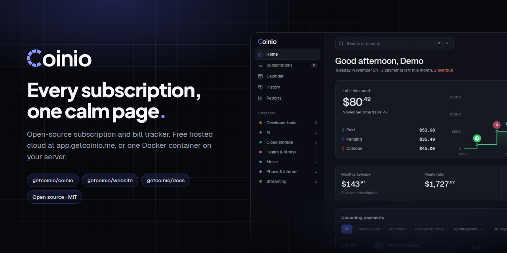

<picture>
  <source media="(prefers-color-scheme: dark)" srcset="https://raw.githubusercontent.com/getcoinio/.github/main/profile/banner-dark.png">
  <source media="(prefers-color-scheme: light)" srcset="https://raw.githubusercontent.com/getcoinio/.github/main/profile/banner-light.png">
  
</picture>

# Coinio

Free, open-source subscription and bill tracker: use the free hosted cloud at [app.getcoinio.me](https://app.getcoinio.me/signup) or self-host in one Docker container on your own server.

[Website](https://getcoinio.me) · [Live demo](https://getcoinio.me/demo/) · [Documentation](https://docs.getcoinio.me) · [Free hosted app](https://app.getcoinio.me/signup)

## Repositories

| Repository | What it is |
| --- | --- |
| [`getcoinio/coinio`](https://github.com/getcoinio/coinio) | Core app, Express API, SQLite, family & shared plans, MCP server, Docker image (`MIT`) |
| [`getcoinio/website`](https://github.com/getcoinio/website) | Marketing site (`getcoinio.me`) in 8 languages, live browser demo & install script |
| [`getcoinio/docs`](https://github.com/getcoinio/docs) | Documentation (`docs.getcoinio.me`), Fumadocs + static Next.js export |

## Quick start (self-hosted)

```sh
curl -fsSL https://getcoinio.me/install | sh
```

Or run the container directly on port **8080** with `/data` mounted:

```sh
docker run -d --name coinio --restart unless-stopped \
  -p 8080:8080 -v coinio-data:/data \
  ghcr.io/getcoinio/coinio:latest
```
